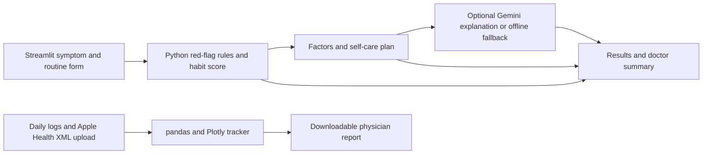

# GutGuide

Educational self-care support for people tracking hemorrhoid-like discomfort, constipation habits, and daily routines.

**2nd place, EIEC x SOPE Physician AI Hackathon.** Built as a team MVP in under two hours, with subsequent integration, documentation, and regression testing.

## Demo

Watch the demo video: [GutGuide Demo](assets/demo.mp4)

## Problem

Patients with rectal discomfort, constipation, bleeding, or straining often need a simple way to understand which symptoms require medical attention and which daily habits may be contributing.

## Solution

GutGuide combines a symptom and routine check, a lightweight tracker, rule-based recommendations, and an optional Gemini patient-friendly summary. Python calculates safety status and the habit score before any AI call. Gemini is prompted to explain those results; its text never changes the stored rule-based decisions.

## Features

- Welcome and education flow with patient goals
- Lifestyle tracker for water, steps, activity, pain, bleeding, and fiber
- Bowel movement log inspired by teammate tracker prototypes
- Fiber insights from safe manual tracking
- Rule-based safety status for red flags
- Constipation and straining risk score
- Main contributing factors and personalized self-care plan
- Optional Gemini summary with a non-AI fallback
- Doctor summary and downloadable physician report
- Apple Health XML upload to prefill steps and active minutes for a selected date

## Demo Walkthrough

1. Review the welcome education and choose personal goals.
2. Open **Self-Care Check** and enter symptoms, bowel habits, and routine details.
3. Review the color-coded safety status, habit score, contributing factors, and self-care plan.
4. Read the optional Gemini explanation or the offline fallback, then download the doctor summary.
5. Open **Symptom Tracker** to log daily metrics and bowel movements, inspect trends, and export a physician report.

The demo video above records the original hackathon experience. Later maintenance changes may differ slightly.

## Tech Stack

- Python
- Streamlit
- pandas
- Plotly
- Google Gemini via `google-genai`

## Run Locally

Use Python 3.11 or newer. From the project directory:

```bash
python3 -m venv .venv
source .venv/bin/activate
python -m pip install -r requirements.txt
streamlit run app.py
```

The demo works without a Gemini API key. In that case, the AI Summary section shows a clean rule-based fallback summary.

`app.py` is the maintained entry point. `gutguide.py` and the two HTML tracker files preserve earlier teammate prototypes.

## Add Gemini API Key

Create `.streamlit/secrets.toml` locally and add a `GEMINI_API_KEY` entry. Use `.streamlit/secrets.toml.example` as the template. The real secrets file is ignored by Git.

You can also set the `GEMINI_API_KEY` environment variable.

The client uses `google-genai` and the `GEMINI_MODEL` constant in `ai_client.py` (default: `gemini-2.5-flash`). A missing key, failed request, or empty response returns the built-in fallback. Tests mock Gemini and require no credentials or paid API calls.

When a key is configured, submitting a Self-Care Check sends the selected answers and rule-based result to Google for summarization. Use synthetic examples for demonstrations; this prototype has no patient consent workflow or compliance certification.

## Architecture



| File | Responsibility |
| --- | --- |
| `app.py` | Welcome, assessment, tracking dashboards, and text report downloads |
| `logic.py` | Deterministic red flags, weighted habit score, factors, and recommendations |
| `ai_client.py` | Secrets/environment configuration, Gemini explanation, and offline fallback |
| `tests/` | Rule boundaries, all 256 risk-factor combinations, mocked Gemini, and Streamlit flows |

The eight-factor score ranges from 0 to 14: Low (0-3), Moderate (4-7), and High (8-14). It is a hackathon heuristic and has not been clinically validated. The no-red-flag status means only that none of the selected form answers triggered the implemented rules.

## Verification

With the virtual environment active:

```bash
python -m compileall -q app.py ai_client.py logic.py gutguide.py tests
python -m unittest discover -s tests -v
```

GitHub Actions runs these checks on pull requests and pushes to `main` using Python 3.11 and 3.12. The suite covers escalation precedence, score boundaries, preservation of the care reminder, key-source precedence, API failures, offline assessment flow, and replacement of repeated daily fiber totals. It checks software behavior, not clinical effectiveness or the medical accuracy of live model output.

## Safety Disclaimer

GutGuide is for educational guidance and self-tracking only. It does not diagnose hemorrhoids or any other condition and does not replace professional medical care. Seek medical care for bleeding, severe pain, black or tarry stool, fever, vomiting, unexplained weight loss, or symptoms that persist or worsen.

## MVP Scope and Limitations

- Tracker data is stored in Streamlit session state and starts with synthetic sample records. It is not a persistent patient database.
- The habit score and recommendations are educational rules, not a validated diagnostic or triage system.
- Gemini follows prompt instructions; generated explanations can still contain errors and are not clinically verified.
- The assessment and daily logs are separate workflows. Logging a symptom alone does not run the assessment's red-flag rules.
- Apple Health support reads an uploaded XML export; it is not a live device connection.
- Fiber grams are manually entered. The app does not infer nutrition from food names.
- Reports download as plain text. Authentication, EHR integration, PDF export, and reminder notifications are not implemented.

## Demo Patient Example

- Bright red bleeding
- Pain level 4/10
- Hard/lumpy stool
- Bowel movements 0-2 times per week
- Often straining
- More than 10 minutes on the toilet
- Less than 4 cups of water daily
- Low fiber and no exercise

Expected demo result: doctor recommended for bleeding, high constipation/straining risk, top factors around hard stool, infrequent bowel movements, straining, toilet time, low fiber, low water, and a self-care plan.

## Team Contributions

GutGuide integrates a team effort: welcome/setup and lifestyle tracking from `welcome-ai-assistant` and `sai`; bowel and symptom tracker ideas from `tracker` and `maren`; the physician-report concept from `Zac`; and fiber-tracking ideas from `suhani---fiber`. The final integration connects those features through the maintained Streamlit entry point, rule-based assessment, and optional Gemini explanation.

The second-place result belongs to the team. The original MVP was built during the hackathon; automated regression tests and the repository documentation were added afterward.

## Future Improvements

- Persist tracker data in a database
- Add clinician-exportable PDF summaries
- Add reminders for hydration, fiber, walking, and symptom checks
- Add optional Apple Health integration beyond XML upload
- Expand accessibility and multilingual support
